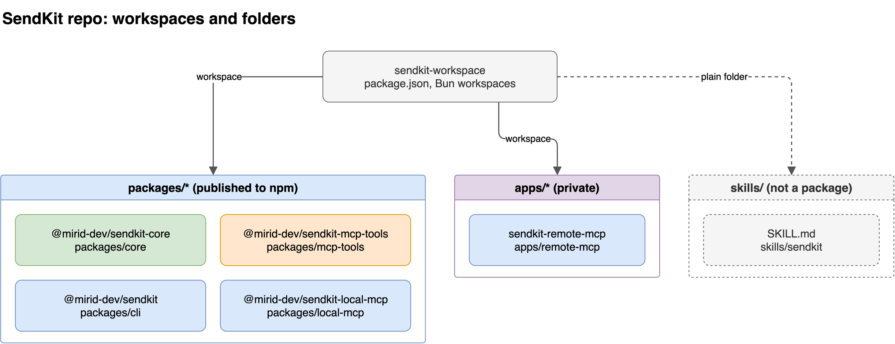
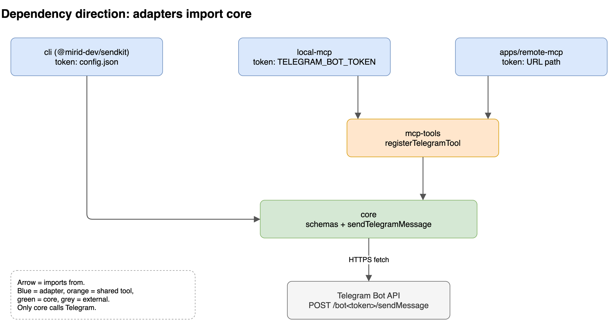
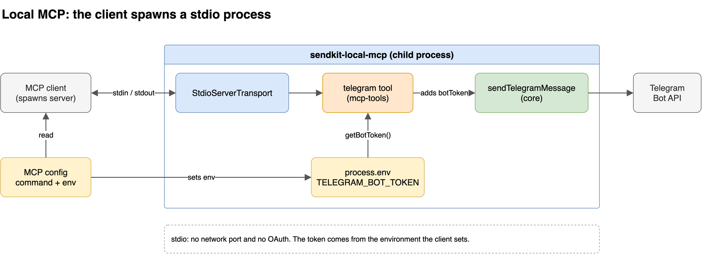
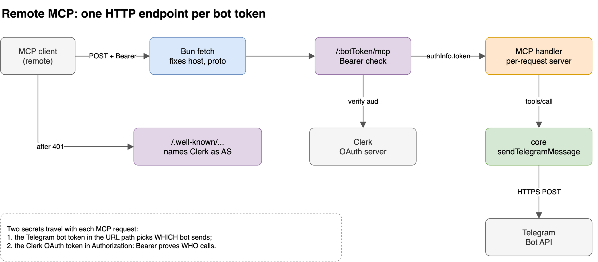

# SendKit architecture

## 1. What this repo is

SendKit sends a Telegram message through the user's own bot. The repo exposes one operation, `sendTelegramMessage`, through three entry points: a command-line tool, a local MCP server, and a remote MCP server.

- **MCP (Model Context Protocol)**: a JSON-RPC protocol that lets an AI client discover and call tools on a server.
- **Adapter**: a package that turns one external interface (argv, stdio, HTTP) into a call to core, and holds no Telegram logic of its own.
- **Bun workspace**: a monorepo layout in which the root `package.json` lists folders whose packages link to each other locally.

The root `package.json` is private, is named `sendkit-workspace`, and declares `"workspaces": ["apps/*", "packages/*"]`. The lockfile is `bun.lock`, and every script runs through Bun.

## 2. Packages and apps

The tree contains four publishable packages, one private app, and one skill folder. Nothing else is present. In particular, no `packages/remote-mcp` exists, and the remote server lives under `apps/`.

| Path                 | npm name                       | Role                                                                    | Published                     |
| -------------------- | ------------------------------ | ----------------------------------------------------------------------- | ----------------------------- |
| `packages/core`      | `@mirid-dev/sendkit-core`      | zod schemas and `sendTelegramMessage`                                   | yes, library                  |
| `packages/mcp-tools` | `@mirid-dev/sendkit-mcp-tools` | `registerTelegramTool(server, getBotToken)`, shared by both MCP servers | yes, library                  |
| `packages/cli`       | `@mirid-dev/sendkit`           | `sendkit init` and `sendkit telegram <chatId> <message>`                | yes, `bin: sendkit`           |
| `packages/local-mcp` | `@mirid-dev/sendkit-local-mcp` | stdio MCP server                                                        | yes, `bin: sendkit-local-mcp` |
| `apps/remote-mcp`    | `sendkit-remote-mcp`           | Streamable HTTP MCP server with Clerk OAuth                             | no, `"private": true`         |
| `skills/sendkit`     | none                           | `SKILL.md`, which is agent instructions                                 | no, not a package             |

_Caption: `skills/` hangs off the root as a plain folder, outside the `apps/*` and `packages/*` workspace globs._

In development the packages resolve each other from source, not from `dist/`. Each library `exports` map lists a `source` condition first (`packages/core/package.json:19-25`). The root `tsconfig.json:6` sets `"customConditions": ["source"]`, and the root dev scripts run `bun --conditions=source …` (`package.json:9-11`). A **condition** is a key in an `exports` map that a resolver selects only when told to. A published consumer never sets `source`, so it receives `dist/`.

## 3. Dependency direction

core owns the schemas and the operation. Every other package imports from core, and core imports only `zod` (`packages/core/package.json:34-36`).

- `packages/core/src/schemas.ts` defines `telegramMessageInputSchema` (`chatId`, `message`), `telegramMessageOptionsSchema` (input plus `botToken`), the Telegram request and response schemas, and `telegramMessageOutputSchema` (`messageId`, `chatId`, `sentAt`).
- `packages/core/src/operations.ts:12-65` exports `sendTelegramMessage`. It parses the options, POSTs to `https://api.telegram.org/bot<token>/sendMessage` with a 10-second `AbortSignal.timeout`, removes the token from network errors (`:36`), validates the response with `safeParse`, and returns the parsed output.
- `packages/mcp-tools/src/index.ts:16-44` registers a tool named `telegram`. It uses `telegramMessageInputSchema` as the input schema and core's output schema with `sentAt` changed to an ISO string, because structured content travels as JSON (`:10-13`).
- `packages/cli/src/index.ts:46-60` validates argv with `telegramMessageInputSchema`, loads the token from `~/.config/sendkit/config.json` (`packages/cli/src/config.ts:7`), and calls `sendTelegramMessage`.
- `packages/local-mcp` and `apps/remote-mcp` depend on `@mirid-dev/sendkit-mcp-tools`, not on core directly. Their `package.json` files do not list core. They reach it transitively.

The adapters differ in one respect only: where the bot token comes from. The CLI reads a file, local-mcp reads an environment variable, and remote-mcp reads a URL path segment. Each passes the token into core, and core validates it with `telegramMessageOptionsSchema.shape.botToken` (`schemas.ts:27-32`). No adapter calls Telegram itself, and no package imports an adapter.

_Caption: every arrow points toward core. Removing any adapter breaks nothing below it._

**One tool call, traced through the code.** A client sends `tools/call` with `name: "telegram"` and `{ chatId, message }`.

1. `McpServer` validates the arguments against `telegramMessageInputSchema`, which `registerTelegramTool` supplied as `inputSchema` (`mcp-tools/src/index.ts:22`).
2. The handler calls `sendTelegramMessage({ ...input, botToken: getBotToken() })` (`:26-29`). `getBotToken` runs on every call, so a missing token fails that call, not server startup (`:15`).
3. core parses the options, builds the snake_case request body, and sends the request (`operations.ts:15-32`).
4. core checks `ok` on Telegram's response. On success it returns `{ messageId, chatId, sentAt: Date }` (`:60-64`).
5. mcp-tools converts `sentAt` to ISO 8601 and returns both a text item and `structuredContent` (`index.ts:31-41`).

## 4. Local MCP

**stdio transport**: the MCP client launches the server as a subprocess and exchanges newline-delimited JSON-RPC messages over the server's stdin and stdout. The spec states: "The client launches the MCP server as a subprocess" and "The server **MUST NOT** write anything to its `stdout` that is not a valid MCP message." Source: <https://modelcontextprotocol.io/specification/2025-06-18/basic/transports>.

`packages/local-mcp/src/index.ts` is 28 lines long:

- It creates `new McpServer({ name: 'sendkit-local-mcp', version })` (`:9-12`).
- It defines `getTelegramBotToken()`, which reads `process.env.TELEGRAM_BOT_TOKEN` and throws if the variable is blank (`:14-22`).
- It calls `registerTelegramTool(server, getTelegramBotToken)` (`:24`).
- It connects a `StdioServerTransport` (`:26-28`).

The file has no HTTP listener and no auth code, and it never writes to stdout. This matches the authorization spec: "Implementations using an STDIO transport **SHOULD NOT** follow this specification, and instead retrieve credentials from the environment." Source: <https://modelcontextprotocol.io/specification/2025-06-18/basic/authorization>.

**Token path.** The user puts the token in the client's MCP config under `env`. The client spawns the process with that environment. The tool reads `process.env.TELEGRAM_BOT_TOKEN` on each call and passes it to core.

Two config forms exist in the repo:

- `.mcp.json.example` runs the workspace copy with `bun run dev:local-mcp`.
- `skills/sendkit/SKILL.md:42-53` runs the published package with `npx -y @mirid-dev/sendkit-local-mcp@latest`.

_Caption: the token enters through the environment the client sets, so this path has no network port and no OAuth step._

## 5. Remote MCP

**Streamable HTTP transport**: the server runs as an independent process that serves one HTTP endpoint and handles many clients. The spec states: "the server operates as an independent process that can handle multiple client connections" and "The server **MUST** provide a single HTTP endpoint path … that supports both POST and GET methods." Source: <https://modelcontextprotocol.io/specification/2025-06-18/basic/transports>.

`apps/remote-mcp/src/index.ts` builds a Hono app and exports a Bun server object (`:116-125`).

**Startup.** The process throws unless `CLERK_PUBLISHABLE_KEY` and `CLERK_SECRET_KEY` are set (`:11-20`). `.env.example` lists both as empty strings. This note does not record any key value.

**Public URL repair.** The exported `fetch` rewrites the request URL from `x-forwarded-proto` and `x-forwarded-host` before Hono sees it (`:118-123`). Behind a proxy or tunnel, every URL the app builds from `c.req.url` then matches the URL the client used. Those URLs include the resource URL and the metadata URL.

**Endpoint per bot.** The MCP route is `app.all('/:botToken/mcp', …)` (`:77`). The bot token is a path segment. As a result, each bot has its own MCP endpoint URL and its own OAuth resource. The route accepts all methods, so GET and DELETE receive the 401 challenge first and then the handler's 405 (`:76`).

**OAuth.** The app is an OAuth resource server, and Clerk is the authorization server. Clerk documents this setup as building "an MCP server using Clerk's OAuth server" (<https://clerk.com/docs/expressjs/guides/ai/mcp/build-mcp-server.md>). The code implements the parts that the MCP authorization spec (<https://modelcontextprotocol.io/specification/2025-06-18/basic/authorization>) assigns to the server:

| Spec requirement                                                                                              | Code                                                                                                                                                                                                           |
| ------------------------------------------------------------------------------------------------------------- | -------------------------------------------------------------------------------------------------------------------------------------------------------------------------------------------------------------- |
| "MCP servers **MUST** implement OAuth 2.0 Protected Resource Metadata (RFC9728)"                              | `GET /.well-known/oauth-protected-resource/:botToken/mcp` returns `generateClerkProtectedResourceMetadata({ publishableKey, resourceUrl, properties: { scopes_supported: ['profile', 'email'] } })` (`:66-74`) |
| "MCP servers **MUST** use the HTTP header `WWW-Authenticate` when returning a 401"                            | `unauthorizedMcpResponse` sets `Bearer resource_metadata="…", scope="profile email"` (`:53-59`)                                                                                                                |
| "authorization **MUST** be included in every HTTP request"                                                    | a request without `Bearer ` returns 401 before anything else runs (`:81-83`)                                                                                                                                   |
| "MCP servers **MUST** validate that access tokens were issued specifically for them as the intended audience" | `clerkClient.authenticateRequest(req, { acceptsToken: 'oauth_token', audience: mcpResourceUrl(c) })` (`:86-91`)                                                                                                |

`scopes_supported` is limited to `profile` and `email`. Clients would otherwise request every scope that Clerk advertises, and the authorize step would fail with `invalid_scope` (`:45-47`). Audience binding requires "Include audience" in Clerk's OAuth settings (`:88-89`).

**Bot token path.** After the gate passes, the route calls `handler.fetch(c.req.raw, { authInfo: { token: botToken, clientId: 'telegram-bot', scopes: [] } })` (`:100-102`). `createMcpHandler` passes that `authInfo` to its factory, and the factory calls `createServer(authInfo?.token ?? '')` (`:41`). `createServer` builds a new `McpServer` and calls `registerTelegramTool(server, () => botToken)` (`:27-36`). The handler therefore builds a server for each request, with that request's bot token captured in its closure. The comment at `:38-40` notes that `authInfo` is reused only because it is the factory's sole per-request input. Its `token` field holds the Telegram bot token, not the Clerk token.

_Caption: Clerk decides whether the request may proceed, and the URL path decides which bot sends the message._

**What the code does not do.** The gate checks that the Clerk token is valid and was issued for this exact URL. It does not connect a Clerk user to a bot. Any user who can sign in to the Clerk instance and knows a bot's URL passes the gate for that bot. The URL is therefore a secret. It can also appear in proxy or access logs, because it sits in the path.

The detailed OAuth discovery sequence and an authenticated call are drawn in the earlier diagrams `diagrams/02-oauth-connect-flow.png` and `diagrams/03-authenticated-tool-call.png`.

## 6. Skill instructions

`skills/sendkit/SKILL.md` gives an AI agent instructions for using SendKit. It is not a package. It has no `package.json`, it falls outside the workspace globs, and it is not published to npm. Changing it affects agent behaviour only.

The skill tells the agent to:

- prefer the `telegram` MCP tool from `@mirid-dev/sendkit-local-mcp`, and fall back to the `sendkit` CLI (`:26-34`);
- never ask for the bot token in chat or put it on a command line (`:24`, `:69`);
- use only packages in the `@mirid-dev` scope (`:15`);
- keep the `@latest` suffix in the `npx` config, because inside this repo a bare name resolves to the local workspace copy and the server fails to start (`:55`).

The skill documents the same inputs and errors that core defines, so it should change whenever `schemas.ts` or `operations.ts` changes.
