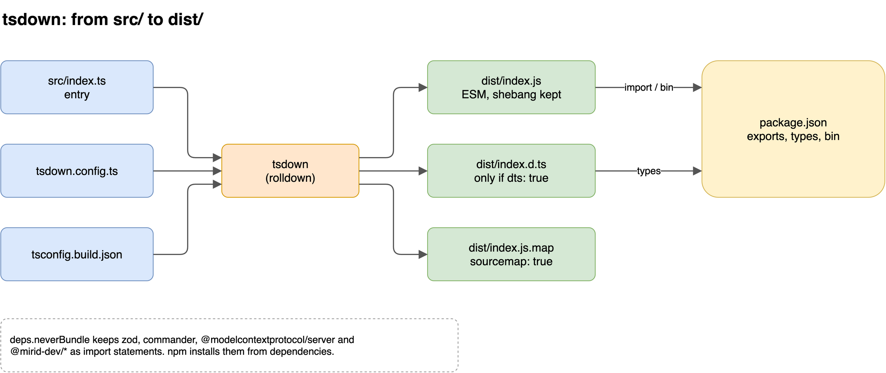
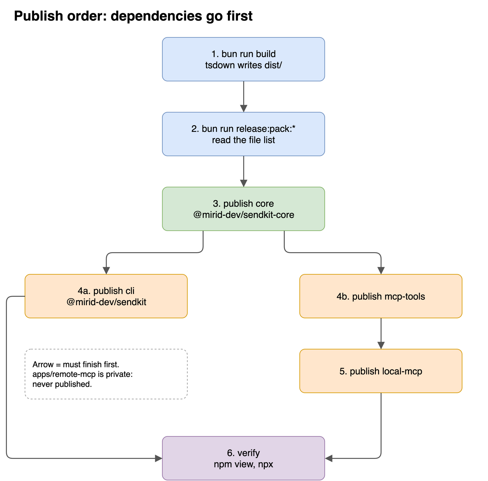
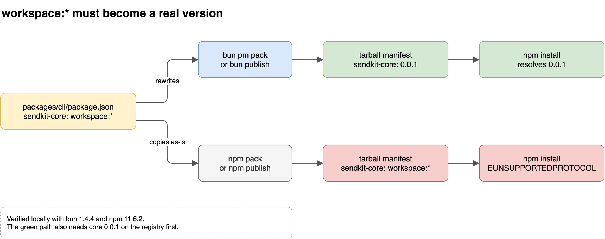

# Publish an npm package with tsdown

This note follows the four publishable packages in this repo. These are `packages/core`, `packages/mcp-tools`, `packages/cli`, and `packages/local-mcp`. `apps/remote-mcp` is `"private": true`, and npm "will refuse to publish it" (<https://docs.npmjs.com/cli/v11/configuring-npm/package-json>).

- **tsdown**: a library bundler built on Rolldown that turns TypeScript entry files into JavaScript and, optionally, `.d.ts` files.
- **Tarball**: the `.tgz` archive that `pack` creates and `publish` uploads. It is the only thing the registry stores.

No command in this note was run against the registry. The build and the `pack` commands were run locally, and the tarballs were written to a scratch directory.

## 1. What tsdown emits

Each package has its own `tsdown.config.ts`, and every `build` script is just `tsdown`. The four configs are identical apart from `dts`, `target`, and the dependency list:

| Option               | core / mcp-tools                      | cli                      | local-mcp          | Meaning                                                                                                                                             |
| -------------------- | ------------------------------------- | ------------------------ | ------------------ | --------------------------------------------------------------------------------------------------------------------------------------------------- |
| `entry`              | `['src/index.ts']`                    | same                     | same               | Starting file of the bundle. "These files serve as the starting points for the bundling process." (<https://tsdown.dev/options/entry>)              |
| `outDir`             | `'dist'`                              | same                     | same               | Output folder. Also the default: "By default, `tsdown` bundles your code into the `dist` directory" (<https://tsdown.dev/options/output-directory>) |
| `format`             | `['esm']`                             | same                     | same               | ES modules only, which matches `"type": "module"`                                                                                                   |
| `dts`                | `true`                                | `false`                  | `false`            | Emit `dist/index.d.ts`. Only libraries need types (<https://tsdown.dev/options/dts>)                                                                |
| `target`             | `node20`                              | `node22.12`              | `node20`           | Matches each package's `engines.node`                                                                                                               |
| `tsconfig`           | `tsconfig.build.json`                 | same                     | same               | Build-only tsconfig with `declaration`, `outDir: dist`, `rootDir: src`                                                                              |
| `sourcemap`, `clean` | `true`                                | same                     | same               | Emit `.js.map` files, and empty `dist/` before each build                                                                                           |
| `outExtensions`      | `.js` / `.d.ts`                       | same                     | same               | Fixes the file extensions that `package.json` points to                                                                                             |
| `deps.neverBundle`   | `zod` (+ core, MCP SDK for mcp-tools) | core, `commander`, `zod` | mcp-tools, MCP SDK | Keep these as `import` statements in the output                                                                                                     |

On `deps.neverBundle`: tsdown already "does not bundle dependencies" listed in `dependencies` or `peerDependencies`. `deps.neverBundle` is the current name of the old `external` option (<https://tsdown.dev/options/dependencies>). The repo lists the same names explicitly, so the externals do not depend on that default.

Running `bun run build` from the root produced the following output (tsdown 0.23.4):

- `packages/core/dist/`: `index.js`, `index.js.map`, `index.d.ts`, `index.d.ts.map`.
- `packages/cli/dist/`: `index.js` (4.21 kB) and `index.js.map`, with no `.d.ts`.
- tsdown keeps the `#!/usr/bin/env node` line from `src/index.ts` and logs `Granting execute permission to dist/index.js` for `cli` and `local-mcp`.
- `import { version } from '../package.json'` is inlined. `packages/cli/dist/index.js` contains `var version = "0.0.1";`. A version bump therefore requires a rebuild, or `--version` reports the old number.
- `dts` generation runs on `typescript@7.0.2` and prints a warning that TypeScript 7's API is experimental. The build still succeeds.


_Caption: `package.json` points only into `dist/`, so publishing without building ships pointers to files that do not exist._

## 2. Package entry points

The **entry points** are the `package.json` fields that tell Node, bundlers, and npm which file to load or link. tsdown can generate them (`exports: true`, <https://tsdown.dev/options/package-exports>). This repo does not use that option and writes them by hand.

**Libraries (`packages/core`, `packages/mcp-tools`):**

```json
"main": "./dist/index.js",
"module": "./dist/index.js",
"types": "./dist/index.d.ts",
"exports": {
  ".": {
    "source": "./src/index.ts",
    "types": "./dist/index.d.ts",
    "import": "./dist/index.js"
  }
},
"files": ["dist", "src"]
```

- `exports` "provides a modern alternative to "main" allowing multiple entry points to be defined" (<https://docs.npmjs.com/cli/v11/configuring-npm/package-json>). `main`, `module`, and `types` remain for older resolvers.
- `source` comes first but applies only when a resolver enables that condition. Inside the repo, the root `tsconfig.json` and the `bun --conditions=source` scripts enable it. A consumer from npm gets `types` and `import`, which point into `dist/`.
- `files` adds `src` to the tarball, so the `source` target exists for anyone who enables the condition. `bun pm pack --dry-run` in `packages/core` lists 10 files: `package.json`, `LICENSE`, `README.md`, four `dist/` files, and three `src/` files.

**Executables (`packages/cli`, `packages/local-mcp`):**

```json
"bin": { "sendkit": "./dist/index.js" },
"files": ["dist"]
```

- `bin` makes npm link the file onto `PATH`. The file "starts with `#!/usr/bin/env node`; otherwise, the scripts are started without the node executable". Source: <https://docs.npmjs.com/cli/v11/configuring-npm/package-json>.
- These packages have no `exports`, because nothing imports them.
- npm always includes `package.json`, `README`, `LICENSE`, and the `bin` file, whatever `files` says (same source). The cli tarball holds 5 files: `package.json`, `LICENSE`, `README.md`, `dist/index.js`, and `dist/index.js.map`.

**Shared fields in all four packages:**

- `"publishConfig": { "access": "public" }`. `publishConfig` is "a set of config values that will be used at publish-time" (same source). For a scoped package it removes the need to pass `--access public`.
- `"prepublishOnly": "bun run build"`. npm defines this hook as: "Runs BEFORE the package is prepared and packed, ONLY on `npm publish`." It does not run on `npm pack` (<https://docs.npmjs.com/cli/v11/using-npm/scripts>). Bun runs `prepublishOnly` only "when `bun publish` packs the package itself". A pre-built tarball such as `bun publish ./pkg.tgz` runs no lifecycle scripts (<https://bun.com/docs/cli/publish>). This is why each `pack:dry` script is `bun run build && bun pm pack --dry-run`. The script builds explicitly because `pack` does not trigger `prepublishOnly`.

## 3. Publish order in this repo

The repo has no publish script. The root `package.json` provides `build`, `build:<pkg>`, and four `release:pack:<pkg>` scripts, and each of those runs the package's `pack:dry`. Publishing is a manual step run from the package directory.

**Dependency graph after packing:**

- `core` depends on `zod` only.
- `mcp-tools` depends on `core`.
- `cli` depends on `core`.
- `local-mcp` depends on `mcp-tools`.

The order follows that graph:

1. **Build.** `bun run build` (root) runs `tsdown` in every `packages/*`.
2. **Dry-run.** `bun run release:pack:core` (and the others) prints the exact file list without writing a tarball. Check that `dist/` is present and that nothing unexpected is included.
3. **Publish core.** In `packages/core`: `bun publish --dry-run`, then `bun publish`.
4. **Publish the direct dependents of core.** Publish `packages/cli` and `packages/mcp-tools` in either order.
5. **Publish local-mcp.** It needs `mcp-tools` at the exact version its manifest pins.
6. **Verify.** Run `npm view <name> version dependencies` for each package, then `npx -y @mirid-dev/sendkit-local-mcp@latest` or `npx @mirid-dev/sendkit --version` from outside the repo.


_Caption: cli and mcp-tools can go in either order, but both must wait for core, and local-mcp must wait for mcp-tools._

**Workspace protocol.** The **workspace protocol** is a dependency specifier such as `workspace:*` that means "the copy in this monorepo". `packages/cli/package.json:27` declares `"@mirid-dev/sendkit-core": "workspace:*"`, and mcp-tools and local-mcp use the same form. The registry cannot resolve that specifier. The pack step must rewrite it to a published version.

Bun does this rewrite. `bun publish` "strips catalog and workspace protocols from the package.json, resolving versions if necessary" (<https://bun.com/docs/cli/publish>). npm does not. Both behaviours were checked locally on `packages/cli`:

| Command                   | `@mirid-dev/sendkit-core` in the tarball's `package.json` |
| ------------------------- | --------------------------------------------------------- |
| `bun pm pack` (bun 1.4.4) | `"0.0.1"`                                                 |
| `npm pack` (npm 11.6.2)   | `"workspace:*"`, unchanged                                |

Installing the npm-built tarball fails with `npm error code EUNSUPPORTEDPROTOCOL` / `Unsupported URL Type "workspace:": workspace:*`. In this repo, publish with `bun publish`, never `npm publish`.


_Caption: the rewrite happens at pack time, so the tool that builds the tarball decides whether the package can be installed._

**Exact pins.** pnpm documents the same rewrite rule that Bun applies here: `workspace:*` becomes the exact version (`1.5.0`), and `workspace:^` becomes `^1.5.0` (<https://pnpm.io/workspaces>). The published manifests confirm exact pins. `npm view @mirid-dev/sendkit dependencies` shows `"@mirid-dev/sendkit-core": "0.0.1"`, and `npm view @mirid-dev/sendkit-local-mcp dependencies` shows `"@mirid-dev/sendkit-mcp-tools": "0.0.1"`. The consequence: a core fix reaches CLI users only after a new CLI version is published that pins the new core. Switching to `workspace:^` would let a patched core reach existing CLI installs without a CLI release.

**Versions.** All four packages are at `0.0.1` in source and on the registry. Once a name and version are published, "that specific name and version combination can never be used again" (<https://docs.npmjs.com/cli/v11/commands/npm-publish>). Every later release therefore starts by changing the `version` field of each package being released. This note does not pick a version number.

## 4. General publish rule

For any package, in any monorepo:

1. **Build.** Produce the files that `main`, `exports`, `types`, and `bin` point to. Rebuild after a version bump if the version is inlined.
2. **Pack or dry-run.** Run `npm pack --dry-run`, `bun pm pack --dry-run`, or `bun publish --dry-run`, and read the file list. `--dry-run` means npm "should only report what it would have done" (<https://docs.npmjs.com/cli/v11/commands/npm-publish>). For a workspace package, also open the packed `package.json` and confirm that no `workspace:` specifier remains.
3. **Publish.** Publish dependencies before dependents, in topological order. Core goes before any package that depends on it.
4. **Verify.** Run `npm view` to confirm the published version and dependencies, then install or `npx` the package from a directory outside the monorepo, so the local workspace cannot satisfy the import.

Two invariants apply throughout:

- The workspace protocol must be rewritten to a published version before the tarball is uploaded.
- Every internal dependency must exist on the registry, at the version the tarball pins, before anyone installs the dependent.

## 5. What fails if skipped

| Skipped step                            | Result                                                                                                                                                                                                                                                                      |
| --------------------------------------- | --------------------------------------------------------------------------------------------------------------------------------------------------------------------------------------------------------------------------------------------------------------------------- |
| Build                                   | `dist/` is in `.gitignore`. On a clean checkout the tarball would contain no `dist/`, so `exports` and `bin` would point at nothing. `prepublishOnly` protects `bun publish` and `npm publish`. It does not protect `bun publish ./pkg.tgz` or `bun pm pack`.               |
| Rebuild after a version bump            | `sendkit --version` reports the old number, because `version` is inlined into `dist/index.js`.                                                                                                                                                                              |
| Pack or dry-run                         | Missing or extra files go unnoticed until a user installs. The `files` list is the only filter, so a wrong entry can ship `src/`, `.env`-style files, or nothing at all.                                                                                                    |
| Workspace rewrite (using `npm publish`) | Installs fail with `EUNSUPPORTEDPROTOCOL`, as reproduced above.                                                                                                                                                                                                             |
| Core first                              | The dependent publishes successfully, but installs fail until core exists. Requesting a version that is not on the registry fails with `npm error code ETARGET` / `No matching version found for @mirid-dev/sendkit-core@99.0.0` (reproduced with `npm install --dry-run`). |
| Version bump                            | The registry rejects the publish, because a published name and version can never be reused.                                                                                                                                                                                 |
| Verify                                  | A broken package stays on the registry until a user reports it. Inside this repo, a bare `npx @mirid-dev/sendkit-local-mcp` resolves the workspace copy (`skills/sendkit/SKILL.md:55`), so verification has to run from outside the repo or use `@latest`.                  |
